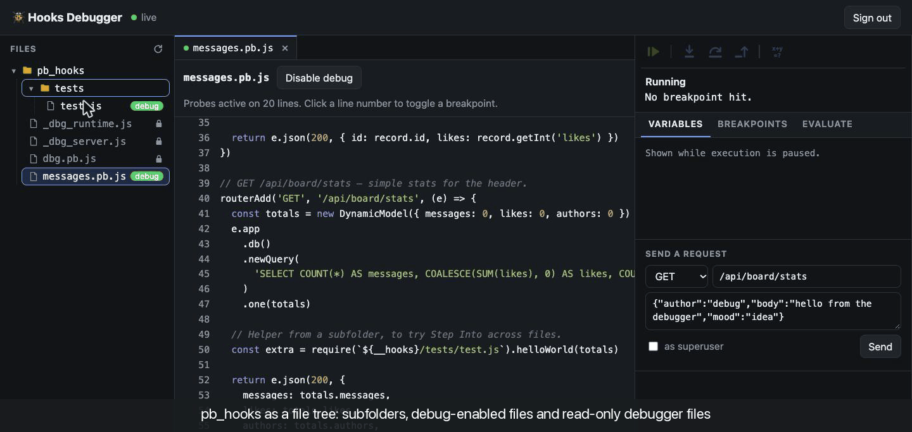
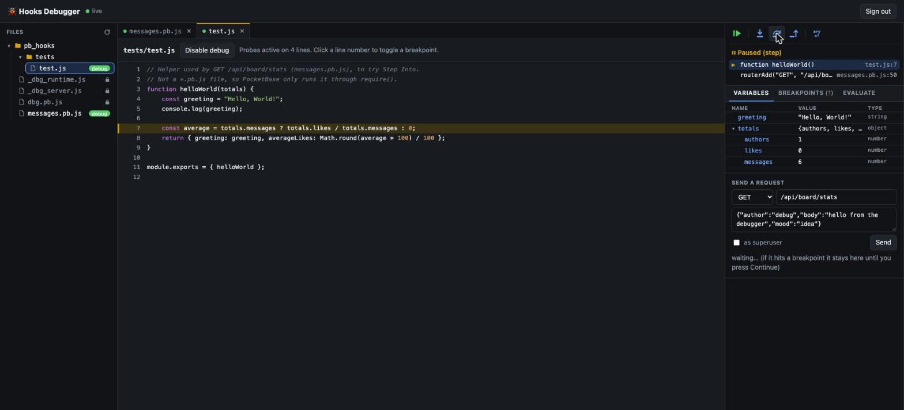

# PocketBase Hooks Debugger

A breakpoint debugger for [PocketBase](https://github.com/pocketbase/pocketbase) JS hooks (`pb_hooks`) that runs entirely inside PocketBase itself. You don't need extra binaries, an IDE or a hosting service: drop three folders next to `pocketbase`, open `/debug/` in the browser, pick a hook file and click a line number. When you trigger the hook, the request pauses there and you can inspect variables, evaluate expressions and step through the code.



It only uses standard JSVM APIs (`sleep()`, `$os`, `$app.store()`, realtime), so it runs on any PocketBase with JS hooks. It was tested with PocketBase **v0.40.6**, both locally (macOS) and on [PocketHost](https://pockethost.io).

## Features

- Browse the files in `pb_hooks`, including subfolders, in a file tree, and open them in editor tabs with syntax highlighting. The debugger's own files are shown read-only (🔒) and can't be debugged.
- Toggle breakpoints by clicking line numbers. Only lines inside handler functions are breakable.
- Pause a live request at a breakpoint. The debugger shows the location and the enclosing hook, e.g. `routerAdd("GET", "/api/board/stats", ƒ)`.
- Inspect local variables in an expandable Name / Value / Type tree. Hook events are summarised: `record`, `collection`, `auth` and `request` come first, internals like `app` are hidden, and `Authorization`/`Cookie` headers are masked.
- Evaluate expressions in the paused scope, e.g. `e.record.get('author')` or `$app.findRecordById(...)`. Expressions can also change state, e.g. `e.record.set(...)`.
- A debug toolbar with **Resume** (F8), **Step Into** (F5), **Step Over** (F6), **Step Out** (F7) and **Evaluate**. Step Into follows calls into other debug-enabled files, e.g. a helper in a subfolder loaded with `require()`.
- A **call stack**. Click a frame to open its file at the calling line and see that frame's variables; **Evaluate** runs in the selected frame.
- **Pause for: Only me** (default) pauses only your own requests: those from the browser running the debugger (it sets a secret `dbg` cookie), with its `X-Dbg` header (copy it for curl or an app on another origin), or from a superuser. Other users' requests run through breakpoints. Switch to **Everyone** to pause any request.
- A built-in request runner, so you can trigger hooks without leaving the page.



## Quick start

1. [Download PocketBase](https://pocketbase.io/docs/) (v0.23+ JSVM API; tested on v0.40.6).
2. Copy `pb_hooks`, `pb_migrations` and `pb_public` from this repo next to the `pocketbase` binary.
3. Create a superuser and start the server:

   ```sh
   ./pocketbase superuser upsert you@example.com your-password
   ./pocketbase serve
   ```

4. Open http://127.0.0.1:8090/debug/ and sign in with the superuser.

The migrations create the debugger's two collections and the demo `messages` collection on first start.

> **Windows:** PocketBase only auto-restarts on `pb_hooks` changes on UNIX-like systems (`--hooksWatch` has no effect on Windows). After **Enable debug** or **Disable debug**, restart `pocketbase serve` manually.

### Adding it to an existing project

You only need the debugger files. The demo message board is optional.

- `pb_hooks/dbg.pb.js`, `pb_hooks/_dbg_runtime.js`, `pb_hooks/_dbg_server.js`
- `pb_migrations/1792866000_create_debugger.js`, `pb_migrations/1792870000_add_dbg_session_stack.js`
- `pb_public/debug/index.html`

### Hosted instances (e.g. PocketHost)

This works the same on any host that runs PocketBase with JS hooks. Upload the same folders and open `https://<your-host>/debug/`. On [PocketHost](https://pockethost.io) the [`phio`](https://pockethost.io/docs/phio) CLI does the upload:

```sh
npm install -g phio tsx   # phio 0.4 runs its TypeScript sources through tsx
phio login
phio link <your-instance>
phio deploy
```

> If hooks and a new migration arrive in the same upload, the instance may restart on the first hook file before the migration has landed. Migrations only run at startup. If the `dbg_*` collections are missing, restart once more, e.g. by re-uploading any hook file.

## Usage

1. Sign in with a superuser account.
2. Select a hook file and click **Enable debug**. PocketBase reloads its hooks within a second or two.
3. Click a line number inside a handler to set a breakpoint.
4. Trigger the hook from your app or from the **Send a request** panel.
5. Inspect **Variables** and type expressions into **Evaluate**. Then press **Resume** (F8), **Step Into** (F5), **Step Over** (F6) or **Step Out** (F7). Click a frame in the call stack to inspect the caller.
6. Click **Disable debug** to restore the original file.

## How it works

Goja, the JS engine inside PocketBase, has no debugging protocol, so the debugger works by **instrumentation**:

1. The browser parses the hook file with [acorn](https://github.com/acornjs/acorn). Before every statement inside a function body, it inserts a probe on the **same line**, so line numbers don't change:

   ```js
   /*@dbg*/;require(__hooks+"/_dbg_runtime.js").bp("messages.pb.js",8,(__dbgx)=>eval(__dbgx),["e","author","body"]);/*@/dbg*/const author = ...
   ```

   Each function body is also wrapped, still on the same lines, in `enter();try{ … }finally{exit()}` so the runtime knows the call stack.

2. The server accepts the instrumented file only if removing every probe and wrapper (matched exactly) gives back the original byte for byte. This means the instrument route can't be used to write arbitrary code. The original is kept in `pb_data/dbg_originals/` and restored when you disable debug.
3. Writing to `pb_hooks` makes PocketBase reload its hooks. From then on, each probe does a cheap check against a breakpoint index kept in `$app.store()`.
4. On a hit, the probe snapshots the locals by evaluating each name through the closure. This is a direct `eval`, so it sees the real scope. The snapshot is stored in a `dbg_sessions` record, and the handler then blocks with `sleep()` while polling that record.
5. The UI receives the session over PocketBase realtime and writes commands (`continue`, `into`, `over`, `out`, `frame`, `eval`) back into the record, where the paused handler picks them up.
6. `require()` caches modules per JS VM, and a VM runs one handler at a time, so the runtime keeps the call stack in a module-level array. **Step Over** pauses at the next line in the same VM at the same or a lower depth; **Step Out** at a lower depth; **Step Into** at the next line anywhere.

## Files

| Path | Purpose |
| --- | --- |
| `pb_public/debug/index.html` | The debugger UI: a single file that loads acorn and the PocketBase JS SDK from a CDN |
| `pb_hooks/dbg.pb.js` | Superuser-only routes: list files, read source, instrument, restore |
| `pb_hooks/_dbg_server.js` | File handling and verification of instrumented sources |
| `pb_hooks/_dbg_runtime.js` | The `bp()` probe: breakpoint checks, pausing, variable snapshots, eval |
| `pb_migrations/1792866000_create_debugger.js` | `dbg_breakpoints` and `dbg_sessions` collections (superuser-only) |
| `pb_migrations/1792870000_add_dbg_session_stack.js` | Adds the call stack fields (`stack`, `frame`) to `dbg_sessions` |
| `pb_hooks/messages.pb.js`, `pb_public/index.html`, `pb_migrations/1792863703_create_messages.js` | Optional demo: a small realtime message board to debug |
| `.phioconfig` | Only used by PocketHost's `phio` CLI; run `phio link` to point it at your own instance |

## Limitations

- Stepping only stops in debug-enabled files, within 3 s; calls into other code run without pausing. Stepping past the end of a handler resumes the request.
- The call stack only contains functions from debug-enabled files. Async and generator functions, and functions starting with a `"use strict"` directive, get line probes but no stack frame.
- The call stack is per JS VM. A hook triggered by another hook (e.g. by `e.app.save()`) may run in a different VM; then it has its own call stack and **Step Over/Out** don't cross between them (**Step Into** does).
- Files instrumented by an older version of the debugger have no stack tracking: click **Disable debug** and **Enable debug** again.
- PocketBase auto-loads only `*.pb.js` hook files. Other `.js` files (e.g. helpers in subfolders) run only when a hook `require()`s them, so their breakpoints only hit then.
- Only statements inside `{ }` blocks of functions can have breakpoints. File-level code and expression-bodied arrow functions can't.
- Breakpoints only pause while a superuser has the debugger open. Each open tab sends a heartbeat every 15 s and a goodbye when it closes; without a heartbeat in the last 90 s, requests run through breakpoints. A forgotten breakpoint therefore can't hang real traffic, e.g. while your app keeps a hosted instance awake. (The realtime connection isn't used for this: behind a proxy the server may keep a closed tab's connection open for minutes.)
- With **Only me**, hooks that don't run for a request (cron jobs, model hooks such as `onRecordAfterCreateSuccess`) never pause; switch to **Everyone** to debug them. The request is found through the hook event in the variables of the outermost debug-enabled function, so the file with the handler must be debug-enabled, not only a helper it calls.
- Only one request can be paused at a time. Other requests run through breakpoints while one is paused.
- A paused request resumes automatically after 5 minutes of inactivity. Proxies in front of PocketBase may time out the client sooner (Cloudflare cuts responses after about 100 s), but the handler stays paused on the server.
- `http.Header` can't be enumerated from the JSVM. Header names in the `e.request` summary come from `e.requestInfo().headers` (lowercase, `_` instead of `-`). Use `e.request.header.get('Name')` to read a specific header.
- Probes add overhead, and enabling or disabling debug restarts the hooks. **Use it on development instances only.**
- While a file is instrumented on a remote server, deploy tools that sync by local hash (like `phio deploy`) won't overwrite it unless the local file changed. Disable debug before real deploys.

## Security

- All debugger routes require superuser auth (`$apis.requireSuperuserAuth()`).
- Both `dbg_*` collections have `null` rules, so only superusers can access them.
- Variable snapshots and eval results are stored in `dbg_sessions`. Sensitive headers are masked, but other values (e.g. record fields) are stored as-is. Clear the collection if that matters.

## License

[MIT](LICENSE)
